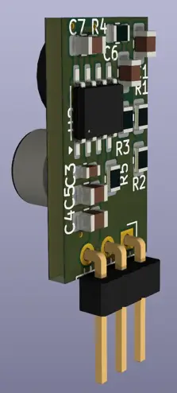
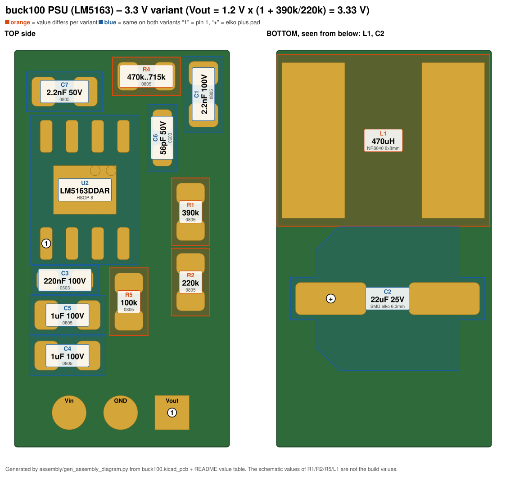
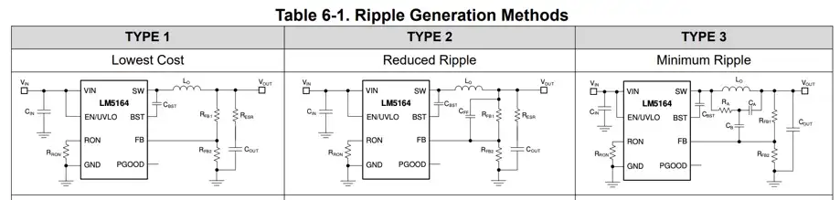

## Specs

|      |          |
|------|----------|
| Vin  | 6..100 V |
| Vout | 2..20 V  |
| Iout | 0.5 A    |
| fsw  | 100 kHz  |

## Feedback Resistor and Indcutor Values

Use the table to find values for Rfb1, Rfb2, Rt, Ra and inductivity for given V_out at ~100khz switching frequency:

| Vout |      | Rfb1 | Rfb2 | Rt   | Ra (R4)    | L     |
|------|------|------|------|------|------------|-------|
| 3.33 |      | 390k | 220k | 100k | 470k..715k | 470uH | 
| 3.35 |      | 430k | 240k | 100k | 470k..715k | 470uH |
| 11.2 |      | 470k | 56k  | 390k | 600k..1.5M | 1.6mH |
| 11.3 |      | 430k | 51k  | 390k | 600k..1.5M | 1.6mH |
| 11.3 |      | 430k | 50k  | 390k | 600k..1.5M | 1.6mH |

* [Common Resistor Values](https://ch00ftech.com/wp-content/uploads/2012/05/resistorsandcaps.pdf)
* LM218x Excel Tool: [Quickstart Calculator](https://www.ti.com/tool/LM5163-LM5164DESIGN-CALC)

## Assembly diagrams

Footprints with the value to place on each, one diagram per variant. Orange boxes differ between
variants, blue boxes are the same on both. L1 and C2 sit on the bottom side; the right half of each diagram
shows that side seen from below. "1" marks pin 1 of U2 and J1, "+" marks the plus pad of the C2 elko.
J1 pinout: 1 = Vout, 2 = GND, 3 = Vin.

The variant values come from the table above (first row of each voltage). The schematic still carries
33k/10k for R1/R2 (Vout ≈ 5.2 V) and 100uH for L1, so do not build from the schematic BOM or the iBOM.

### 3.3 V



### 11 V


Regenerate after a layout or value change with KiCad's Python:
`/Applications/KiCad/KiCad.app/Contents/Frameworks/Python.framework/Versions/Current/bin/python3 assembly/gen_assembly_diagram.py`

## LM516x features

* [LM5163](https://www.ti.com/lit/ds/symlink/lm5163.pdf) (.5A) LM5164](https://www.ti.com/lit/ds/symlink/lm5164.pdf) (
  1A)
* sync buck with nearly 100% max duty cycle
* 0.725Ω NFET buck switch, 0.34Ω NFET synchronous rectifier
* constant on-time (COT) control architecture
* light-load power saving mode
* 10.5µA no-load input quiescent current
* soft-start, UVLO, thermal shutdown
* PGOOD indicator
* quick start calc: https://www.ti.com/tool/LM5163-LM5164DESIGN-CALC



## Pin-compatible chips

| MPN          | Vi  | Io   | NFET Rds  | Iq    |                  | Light-Load |                                                                   |
|--------------|-----|------|-----------|-------|------------------|------------|-------------------------------------------------------------------|
| LM5168       | 120 | 0.3  | 1.9/.71Ω  | 10µA  | COT, FPWM or PFM | DEM        | [pdf](https://www.ti.com/lit/ds/symlink/lm5169.pdf)               |
| LM5169       | 120 | 0.65 | 1.9/.71Ω  | 10µA  | COT, FPWM or PFM | DEM        | [pdf](https://www.ti.com/lit/ds/symlink/lm5169.pdf)               |
| LM5163       | 100 | 0.5  | .725/.34Ω | 10µA  | COT              | DEM        | https://www.ti.com/lit/ds/symlink/lm5163.pdf?ts=1731081870545     |
| LM5164       | 100 | 1.0  | .725/.34Ω | 10µA  | COT              | DEM        | https://www.ti.com/lit/ds/symlink/lm5163.pdf?ts=1731081870545     |
| LM5017       | 100 | 0.6  |           |       | COT              |            |                                                                   |
| LM34927      |     |      |           |       |                  |            |                                                                   |
| *TPP00031/2* | 100 | 0.3  | .7/.3Ω    | 125µA | pulse skip       |            | [pdf](https://static.3peak.com/res/doc/ds/Datasheet_TPP0003x.pdf) |

* [WEBENCH Power Designer]( https://webench.ti.com/power-designer/switching-regulator?base_pn=LM5163&origin=ODS&litsection=features)
* https://webench.ti.com/power-designer/switching-regulator/select

## inductors

requirements:

* Isat well above current limit setting
* Isat decreases with rising temperature
* refer to datasheet [pg 18](https://www.ti.com/lit/ds/symlink/lm5163.pdf#page=18)

|                      | L     | Isat(30%) | DCRmΩ(max) | Q         | px(250) | size | Notes                                                                                           |
|----------------------|-------|-----------|------------|-----------|---------|------|-------------------------------------------------------------------------------------------------|
| MSS1260-124KL        | 120uH | 2A        | 195        |           | 1,33€   | 12mm | LM5163 datasheet                                                                                |
| Bourns SRN6045-101M  | 100uH | .7A       | 494        | 22@796kHz | $,27    | 6mm  |                                                                                                 |
| VLS5045EX-101M       | 100uH | .7A       | 754        |           | $,20    | 5mm  | ordered                                                                                         |
| → TY NRS8040T101MJGK | 100uH | 1.1A      | 364        |           | $,22    | 8mm  | [pdf](https://mm.digikey.com/Volume0/opasdata/d220001/medias/docus/2544/NRS8040T101MJGK_SS.pdf) |
| IFSC3232DBER471M02   |       |           |            |           |         |      |                                                                                                 |
|                      |       |           |            |           |         |      |                                                                                                 |

## Other designs using same chip

* https://github.com/90wishpack/LM5164
* https://github.com/FarwayDot/Adapter_PowerSupply_Vigi

# Tests

```
3.3V version:
Vin=15
no load: voltage can oscillate arround 3.3V
750Ω load: voltage stable
short circuit: 50mA Iin
```
